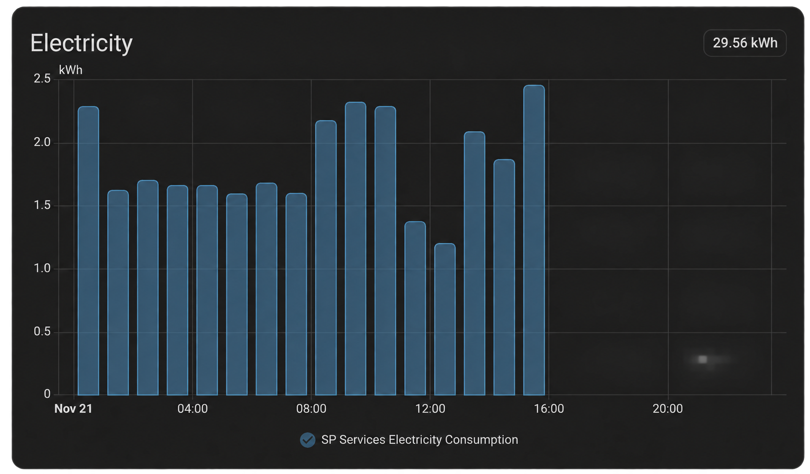

# SP Services Singapore

Unofficial Home Assistant integration for electricity consumption from SP Services Singapore. It fetches the 30-minute readings shown in the SP Utilities app and portal, then publishes hourly usage statistics for Home Assistant's Energy dashboard.

*SP Services electricity consumption in the Home Assistant Energy dashboard.*

**Note:** Readings are typically 6-8 hours delayed.

## What it does

- Fetches the current and the two previous days every 30 minutes.
- Combines half-hour kWh readings into hourly Home Assistant statistics.
- Re-fetches recent days so changes to SP's recent readings can correct the statistics.
- Provides diagnostic sensors for the latest interval and last successful update.

## Before you begin

1. Set up your SP Utilities account and electricity service in the SP app or portal.
2. Have the account email and password ready, plus the numeric electricity account number for the meter you want to monitor. The account number is shown on SP bills and in account details.
3. Make sure Home Assistant can connect to the Internet for SP login and data updates.

## Install

Install this repository as a custom integration through the Home Assistant Marketplace (HACS):

1. Select **Open the repository in Home Assistant** above. If prompted, enter the address of your Home Assistant instance into My Home Assistant.
2. In Marketplace, add the repository as a custom **Integration** if asked, then select **Download** or **Install**.
3. Restart Home Assistant so it can load the integration.
4. Go to **Settings → Devices & services → Add integration**, search for **SP Services Singapore**, and open it.

If the button does not work, add `https://github.com/s0ftice/ha-sp-services` manually through HACS → custom repositories, choose **Integration**, install it, and restart Home Assistant.

## Set up the integration

1. Enter the email and password used for your SP Utilities app or SP Services portal, together with your electricity account number.
2. If SP requests multifactor authentication, enter the SMS OTP sent to your enrolled mobile phone.
3. Wait for the initial data fetch to finish. Home Assistant creates the electricity statistics and diagnostic sensors.

The password and SMS OTP are used during sign-in and are not saved by the integration. The SP access, ID, and refresh tokens are stored in the Home Assistant config entry so the integration can continue polling.

## Add it to the Energy dashboard

Go to **Settings → Dashboards → Energy** and add a grid connection with these choices:

- **Energy imported from grid:** `SP Services Electricity Consumption`
- **Energy exported to grid:** leave unselected
- **Display name:** `SP Services Electricity Consumption` (default)
- **Cost tracking:** Do not track costs
- **Type of power measurement:** No power sensor

The integration provides imported energy in kWh. It does not currently provide grid export, electricity costs, or instantaneous power in W/kW.

## Data and limitations

- SP readings may be several hours behind actual usage.
- The current day and two previous calendar days are re-fetched, so the integration can correct recent changes. It does not backfill history older than this rolling window before initial setup.
- SP may change the undocumented endpoints or authentication flow without notice.

## Credits and license

Built with help from [OpenAI Codex](https://openai.com/codex/).
This project is distributed under the [MIT License](LICENSE).
